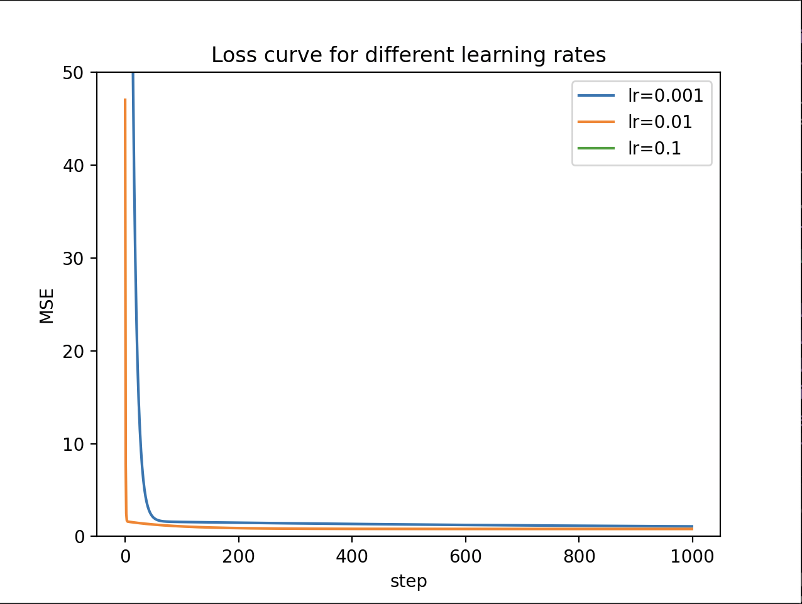
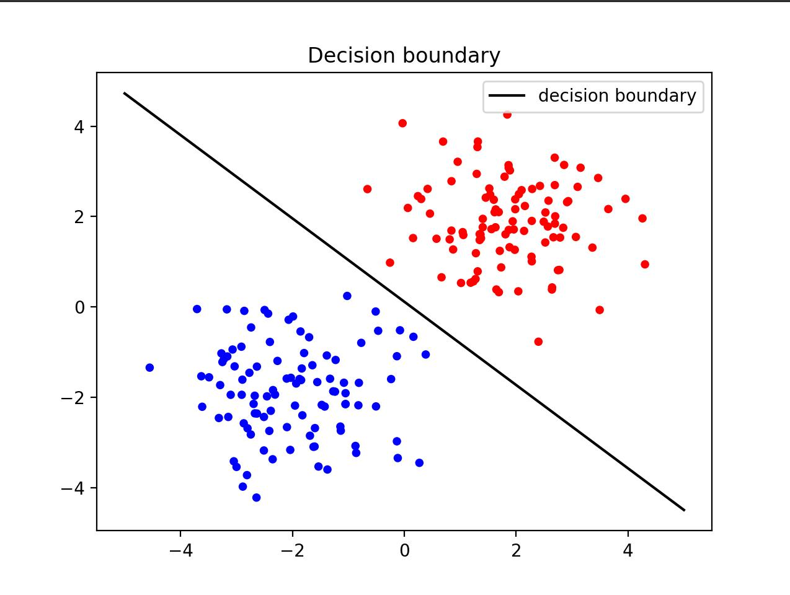
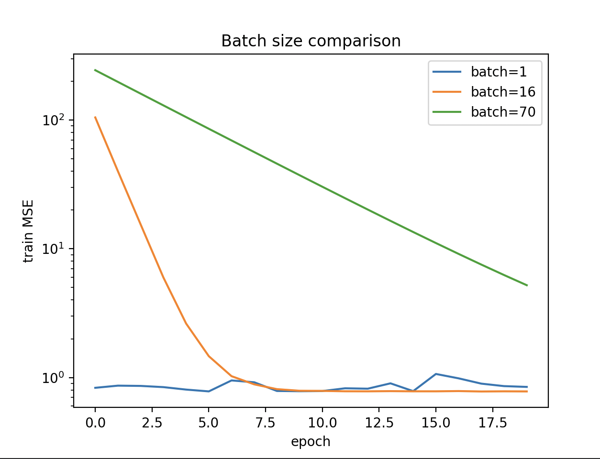

# Week 3: Regression from Scratch Lab

## Task
I built linear regression and logistic regression (binary classification)
from scratch, using only NumPy and matplotlib for graphs, without sklearn
or PyTorch. Both models are trained with gradient descent, and their
gradients are checked numerically.

## Files
- `linear_regression.py`: `predict`, `mse_loss`, `mae_loss`, `mse_gradients`, `fit_gd`, `fit_minibatch`
- `logistic_regression.py`: `sigmoid`, `predict_proba`, `predict`, `bce_loss`, `bce_gradients`, `fit_gd`, metrics
- `experiments.py`: train/val/test split, standardization, learning rate and batch size experiments
- `tests.py`: shapes, loss decrease, numerical gradient checks, metrics
- `results.md`: tables, observations and conclusions
- `numerical_grad.py`: central difference (from week 2)

## How to run
    cd week3
    python3 tests.py
    python3 experiments.py

## Results
- Linear regression learned w = 2.955, b = 2.208 (true values: 3 and 2) with lr = 0.01.
- Logistic regression reached accuracy, precision, recall and F1 = 1.0 on the test set.
- All 10 gradient checks pass, the largest relative error is 1.24e-10.

Details are in `results.md`.

## Graphs

